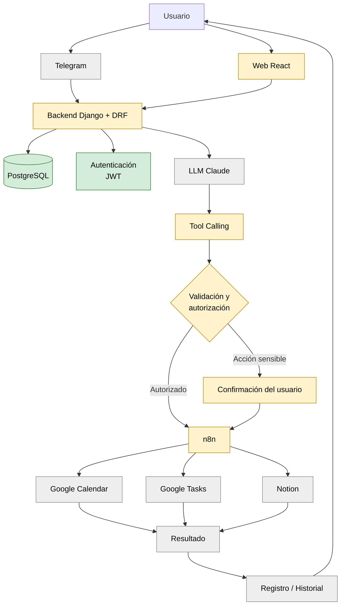

# Arquitectura del MVP — KEFA AI

**Última actualización:** 11 de octubre de 2026 (código: `develop` @ `954b34b`)
**Ticket:** KEFA-003 → Jira KEFA-20 (Finalizada)
**Revisión con el equipo:** registrada como Finalizada en Jira (KEFA-30). No hay acta en el repositorio; falta adjuntar fecha y acuerdos.
**Fuente de las decisiones:** Biblia del Proyecto (§5–§12) y `control-de-estado.md`. Este documento describe el sistema **real**: lo que no existe aparece como pendiente.

---

## 1. Objetivo y alcance

KEFA AI recibe instrucciones en lenguaje natural, las interpreta con un LLM y coordina herramientas externas (Google Calendar, Google Tasks, Notion) a través de n8n.

**Principio fundamental (Biblia §6):** la IA propone una acción; el sistema decide si está permitida; después se ejecuta. La IA nunca ejecuta código arbitrario, accede a la base de datos ni obtiene credenciales.

---

## 2. Diagrama de arquitectura

Flujo objetivo del MVP. Los colores indican el estado de implementación al 11-oct-2026.



**Leyenda:** verde = implementado · amarillo = parcial · gris = sin implementar.
Notion es opcional en el MVP (interpretación del equipo sobre la Biblia §14, pendiente de confirmar).

---

## 3. Estado de implementación

| Componente | Responsable | Estado | Ubicación en el repo |
|---|---|---|---|
| Backend (API REST) | Kevin | 🟡 Auth y health; sin endpoints de conversación | `backend/config`, `backend/users` |
| PostgreSQL | Kevin | 🟡 Solo modelo `User` | `docker-compose.yml`, `backend/users/migrations` |
| Autenticación JWT | Kevin | 🔴 Implementada; config duplicada en `settings.py` (ver control de estado, H1) | `backend/users`, `backend/config/settings.py` |
| Catálogo de herramientas | Fanny | ✅ 11 herramientas; no conectado | `backend/tool_catalog` |
| Orquestador | Fanny | 🟡 Componentes base; sin integrar | `backend/orchestrator` |
| LLM | Fanny | ❌ Proveedor decidido (Claude); sin código | — |
| n8n | Eric | 🟡 Servicio en Docker; sin workflows | `docker-compose.yml`, `n8n/README.md` |
| Telegram, Calendar, Tasks, Notion | Eric | ❌ Sin código | — |
| Frontend | Alan | 🟡 Maquetado; login simulado | `frontend/src` |
| Docker | Alan | 🟡 4 servicios; sin verificar de punta a punta | `docker-compose.yml`, `*/Dockerfile`, `docker/` |

---

## 4. Componentes

### 4.1 Backend (Django + DRF)

- **Objetivo:** exponer la API REST; es el único componente con acceso a PostgreSQL y el que aplica validación y autorización antes de ejecutar acciones.
- **Existe:** registro, login, refresh y verificación de tokens, `GET /api/users/me/` y `GET /api/health/`. Detalle en [`docs/api/usuarios-autenticacion.md`](../api/usuarios-autenticacion.md).
- **Configuración:** `JWTAuthentication` + `IsAuthenticated` por defecto; CORS con `django-cors-headers` leyendo `CORS_ALLOWED_ORIGINS` del entorno; secretos desde variables de entorno (`SECRET_KEY` obligatoria).
- **Pendiente:** endpoints para recibir mensajes de Telegram/Web, invocar al orquestador y registrar resultados; modelos de conversaciones, acciones y auditoría.
- **Pruebas:** 12 de autenticación y 2 de health (no ejecutadas en la última revisión).

### 4.2 PostgreSQL

- **Objetivo:** persistir usuarios, historial de conversación, acciones y resultados. Solo el backend escribe; la IA nunca accede a la base (Biblia §5).
- **Existe:** modelo `users.User` y migración `0001_initial`. En Docker, un segundo script crea `n8n_db` para n8n.
- **Imagen:** `postgres:17-alpine` (cambio posterior a KEFA-ADR-004, pendiente de registrar como adenda).
- **Pendiente:** esquema de conversaciones, acciones y auditoría.

### 4.3 Autenticación y seguridad de acceso

- JWT: access 5 min, refresh 1 día, cabecera `Bearer`, firmado con `SECRET_KEY`.
- El registro no permite asignar privilegios; las contraseñas se guardan con hash y se validan con los validadores de Django.
- **Puntos abiertos:** rate limiting, clave de firma JWT independiente, revocación de refresh, OAuth 2.0 para servicios externos.
- El frontend no es una capa de autorización: ocultar un botón o una ruta no protege nada.

### 4.4 Catálogo de herramientas y Tool Calling

- **Objetivo:** capa que convierte la intención del LLM en una llamada validable; el modelo solo puede pedir herramientas del catálogo.
- **Catálogo (Biblia §11), implementado en `backend/tool_catalog/`:**

```text
calendar.create_event   calendar.get_events   calendar.update_event   calendar.delete_event
tasks.create            tasks.list            tasks.complete          tasks.delete
notion.create_page      notion.search         notion.update_page
```

- Cada herramienta define nombre, descripción, `parameters` (JSON Schema reducido), permisos, nivel de riesgo y si requiere confirmación (`calendar.delete_event` y `tasks.delete` la exigen).
- `validate_tool_call` valida existencia, parámetros y permisos; `prepare_tool_call` deja la llamada lista para n8n **sin ejecutarla**.
- **Pendiente:** procesar las tool calls que devuelva el LLM y ejecutar vía n8n (Jira KEFA-134). Documentación detallada: [`docs/tools/catalogo-herramientas.md`](../tools/catalogo-herramientas.md).

### 4.5 Orquestador

- **Objetivo:** decidir qué hacer con una acción propuesta (ejecutar, pedir confirmación o rechazar).
- **Existe:** entrada y salida estándar, flujo de decisión, validación de herramienta y parámetros, control de permisos, confirmaciones, errores y registro en memoria.
- **Pendiente:** conectarlo con el catálogo, el LLM, la base de datos y un endpoint. Detalle en [`orquestador.md`](orquestador.md).

### 4.6 IA / LLM

- **Decisión:** Claude (Anthropic), registrada en Jira KEFA-125 el 7-oct-2026. La integración se hará por la API de Anthropic, con la clave en variables de entorno.
- **Debe hacer:** interpretar lenguaje natural, extraer parámetros, proponer una herramienta del catálogo, mantener contexto y redactar la respuesta.
- **No debe hacer (Biblia §5):** ejecutar código arbitrario, acceder a la base de datos, inventar herramientas, obtener credenciales.
- **Pendiente:** servicio de integración, prompts versionados, ADR del proveedor y retirar `OPENAI_API_KEY` de `.env.example`.

### 4.7 n8n

- **Objetivo:** ejecutar la automatización final una vez validada y autorizada la acción.
- **Configuración (KEFA-ADR-004):** imagen oficial `docker.n8n.io/n8nio/n8n:2.40.7` (nunca `latest`/`next`/`nightly`), base de datos PostgreSQL `n8n_db`, contraseña por Docker secret, `N8N_ENCRYPTION_KEY` por entorno.
- **Regla:** los workflows exportados se versionan en `n8n/workflows/` solo tras sanitizarlos (ver `n8n/README.md`).
- **Pendiente:** crear `n8n/workflows/`, el webhook, la autenticación del origen y el primer workflow (Calendar `create_event`).

### 4.8 APIs externas

| Servicio | Uso previsto | Estado |
|---|---|---|
| Telegram Bot API | Canal principal de entrada del MVP | Sin código (Jira: bot creado) |
| Google Calendar API | Crear, consultar, modificar y eliminar eventos | Sin código |
| Google Tasks API | Crear, listar, completar y eliminar tareas | Sin código |
| Notion API | Crear, buscar y actualizar páginas | Opcional en el MVP |

Todas pasan por n8n; el backend no se conecta directamente (Biblia §7).

### 4.9 Frontend (React + Vite)

- **Objetivo del MVP:** dashboard básico con historial de acciones y gestión de servicios conectados.
- **Existe:** login y dashboard maquetados, navegación (`/login`, `/dashboard`, `/conversaciones`, `/configuracion`, `/cuenta`), modo claro/oscuro, cliente HTTP con `fetch` y comprobación de `/api/health/`.
- **Limitación importante:** el login **no llama al backend** y las rutas no tienen guard.
- **Pendiente:** login con JWT, guard de rutas, pantalla de registro, historial real.

### 4.10 Docker e infraestructura

- Servicios: `db`, `n8n`, `backend`, `frontend` en la red `kefa-network`.
- Contraseña de Postgres por Docker secret (`secrets/postgres_password.txt`, no versionado); el entrypoint del backend la convierte en variable de entorno.
- Backend publicado en el puerto `8080` del host (workaround local; ver control de estado, H5).
- `.env.example` define `POSTGRES_PASSWORD` aunque la contraseña se entrega por Docker secret; ambas no pueden coexistir en el servicio `db` (ver control de estado, H9).

---

## 5. Flujo de una solicitud: objetivo vs. estado actual

| Paso | Descripción | Estado |
|---|---|---|
| 1 | El usuario escribe por Telegram o Web | ❌ Telegram; 🟡 Web (sin login real) |
| 2 | El backend autentica la petición (JWT) | ✅ Implementado (con el bug de configuración) |
| 3 | El LLM interpreta e identifica herramienta y parámetros | ❌ |
| 4 | Se valida herramienta, parámetros y permisos | 🟡 Existe en `tool_catalog` y `orchestrator`, sin conectar |
| 5 | Si la acción es sensible, se pide confirmación | 🟡 Lógica de decisión; falta el diálogo con el usuario |
| 6 | n8n ejecuta la acción en el servicio externo | ❌ |
| 7 | Se registra el resultado | 🟡 Registro en memoria; sin persistencia |
| 8 | Se informa al usuario | ❌ |

---

## 6. Flujo de seguridad

Basado en las secciones 10 y 12 de la Biblia.

1. Toda petición pasa por autenticación (JWT). *Implementado.*
2. La IA propone una acción; nunca la ejecuta.
3. El backend valida que la herramienta pertenezca al catálogo, que los parámetros cumplan el esquema y que el usuario tenga permisos. *Lógica implementada; sin conectar.*
4. Las acciones sensibles (eliminar evento o tarea, modificar información importante, ejecutar automatizaciones) exigen confirmación explícita. La confirmación debe provenir del usuario y guardarse en el servidor, nunca de la salida del LLM.
5. Solo entonces se dispara la ejecución vía n8n.
6. Se registra el resultado (auditoría). *Pendiente de persistencia.*
7. Amenazas a cubrir: prompt injection, tool manipulation, parameter manipulation, data leakage, escalada de privilegios. *Revisión pendiente (Jira KEFA-153).*
8. Ningún secreto se expone en el frontend ni se versiona en Git (`.gitignore` excluye `.env*` y `secrets/*`).

**Ejemplo de confirmación (Biblia §12):**

```text
IA:      "He encontrado el evento 'Reunión de equipo' y se solicita eliminarlo.
          ¿Deseas confirmar la eliminación?"
Usuario: "Sí"
Sistema: Ejecutar acción.
```

---

## 7. Decisiones registradas

| Decisión | Fuente | Estado |
|---|---|---|
| Imagen oficial de n8n con versión fija, base de datos en PostgreSQL, secretos por `_FILE` | KEFA-ADR-004 | ✅ Aprobada |
| Postgres 17 y `N8N_WEBHOOK_URL` | Comentarios en `docker-compose.yml` | Falta adenda al ADR-004 |
| Proveedor LLM: Claude | Jira KEFA-125 | Falta ADR |
| JWT con access 5 min / refresh 1 día, login por `username` | `docs/api/usuarios-autenticacion.md` | Documentada |
| Estructura del repo distinta a la Biblia §15 (`backend/users`, `backend/tool_catalog`, `backend/orchestrator`) | Estado real del repo | Falta registrarla |

---

## 8. Pendientes abiertos

- Corregir la configuración duplicada de CORS en `settings.py`.
- Esquema de base de datos para conversaciones, acciones y auditoría.
- Integración del LLM y de Tool Calling.
- Workflows de n8n, webhook y callbacks.
- Integraciones con Telegram, Calendar y Tasks.
- Login real en el frontend.
- Revisión de seguridad del MVP.
- Adjuntar el acta de la revisión de arquitectura (Jira KEFA-30) o registrar los acuerdos.
